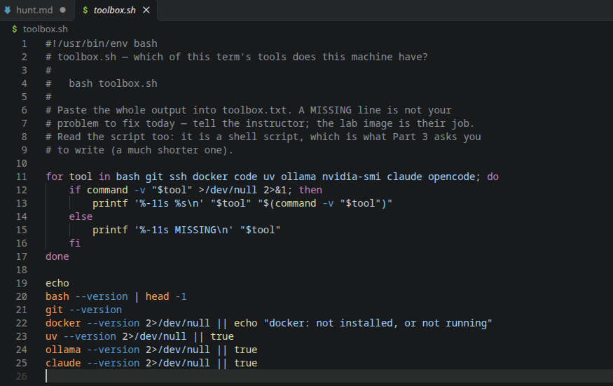

# ITAS 170 Lab 01
All 5 parts of the first lab for ITAS170 - IT Tools and Techniques

## Part 1

```
bash        /usr/bin/bash
git         /usr/bin/git
ssh         /usr/bin/ssh
docker      /usr/bin/docker
code        /usr/bin/code
uv          /home/aidenadzich/.local/bin/uv
ollama      /usr/local/bin/ollama
nvidia-smi  /usr/bin/nvidia-smi
claude      /home/aidenadzich/.local/bin/claude
opencode    /home/aidenadzich/.opencode/bin/opencode

GNU bash, version 5.3.15(1)-release (x86_64-redhat-linux-gnu)
git version 2.56.1
Docker version 29.9.3, build 1.fc45
uv 0.13.9 (x86_64-unknown-linux-gnu)
Warning: could not connect to a running Ollama instance
Warning: client version is 0.40.16
2.1.327 (Claude Code)
```



## Part 2

### 1. **How many requests are in the log?**

Command:

`wc -l access.log`

Result:

`2400 access.log`


### 2. **How many requests were answered with status 404?**

Command:

`cut -d' ' -f9 access.log | grep -c '^404$'`

Result:

`199`

### 3. **Which five clients made the most requests, and how many each?**

Command:

`cut -d' ' -f1 access.log | sort | uniq -c | sort -nr | head -5`

Result:

```
335 66.249.66.17
164 185.220.101.42
126 142.232.10.25
124 142.232.10.22
116 142.232.10.27
```

### 4. **Which hour of the day is busiest across the whole log?**

Commands:

`cut -d' ' -f4 access.log | cut -d: -f2 | sort | uniq -c | sort -nr | head -3`

Result:

```
251 13
185 12
178 11
```

### 5. **How many distinct paths were requested?**

Command:

`cut -d' ' -f7 access.log | sort | uniq | wc -l`

Result:

`18`

### 6. **Which path produced the most 404s, and how many? Look at who is asking**

Command:

`cut -d' ' -f7,9 access.log | grep ' 404$' | sort | uniq -c | sort -nr | head -5`

Result:

```
82 /wp-login.php 404
35 /admin 404
30 /xmlrpc.php 404
27 /wp-admin/ 404
25 /.env 404
```

Command:

`grep '" 404 ' access.log | cut -d' ' -f1 | sort | uniq -c | sort -nr | head -5`

Result:

```
164 185.220.101.42
  8 66.249.66.17
  4 142.232.10.27
  3 142.232.10.24
  3 142.232.10.22
```

### 7. **What was the largest single response — its path and its size in bytes?**

Command:

`cut -d' ' -f7,10 access.log | sort -k2 -nr | head -1`

Result:

`/downloads/itas170-lab1.pdf 2097152`

### 8. **How many requests came from the Googlebot crawler? Then count lines containing bot case-insensitively and explain, in one sentence, why the two numbers differ.**

Command:

`grep -c 'Googlebot' access.log`

Result:

`335`

Command:

`grep -ci 'bot' access.log`

Result:

`374`

### 9. **How many requests happened on 12 September?**

Command:

`cut -d' ' -f4 access.log | grep -c '12/Sep/2026'`

Result:

`744`

### 10. **How many POST requests are there, and how many of those were to `/wp-login.php`?**

Command:

`cut -d' ' -f6,7 access.log | grep -c '^"POST'`

Result:

`132`

Command:

`cut -d' ' -f6,7 access.log | grep -c '^"POST /wp-login.php$'`

Result:

`45`

## Part 3

[Script](./hello-tools)
```bash
aidenadzich@Aidens-PC:~/Documents/ITAS170/lab_01$ mkdir -p ~/code/ITAS170/bin
aidenadzich@Aidens-PC:~/Documents/ITAS170/lab_01$ cd ~/code/ITAS170/bin/
aidenadzich@Aidens-PC:~/code/ITAS170/bin$ nano hello-tools
aidenadzich@Aidens-PC:~/code/ITAS170/bin$ ./hello-tools
bash: ./hello-tools: Permission denied
aidenadzich@Aidens-PC:~/code/ITAS170/bin$ ls -l hello-tools 
-rw-r--r--. 1 aidenadzich aidenadzich 188 Nov 18 20:28 hello-tools
aidenadzich@Aidens-PC:~/code/ITAS170/bin$ chmod +x hello-tools 
aidenadzich@Aidens-PC:~/code/ITAS170/bin$ ls -l hello-tools 
-rwxr-xr-x. 1 aidenadzich aidenadzich 188 Nov 18 20:28 hello-tools
aidenadzich@Aidens-PC:~/code/ITAS170/bin$ ./hello-tools 
Hello from aidenadzich on Aidens-PC
You are standing in: /home/aidenadzich/code/ITAS170/bin
The time is 20:28 and your shell is /bin/bash
aidenadzich@Aidens-PC:~/code/ITAS170/bin$ cd ~
aidenadzich@Aidens-PC:~$ hello-tools
bash: hello-tools: command not found...
aidenadzich@Aidens-PC:~$ echo "$PATH" | tr ':' '\n'
/home/aidenadzich/.opencode/bin
/home/aidenadzich/.local/bin
/home/aidenadzich/bin
/usr/local/bin
/usr/bin
/bin
aidenadzich@Aidens-PC:~$ nano .bashrc
aidenadzich@Aidens-PC:~$ source ~/.bashrc
aidenadzich@Aidens-PC:~$ hello-tools
Hello from aidenadzich on Aidens-PC
You are standing in: /home/aidenadzich
The time is 20:31 and your shell is /bin/bash
aidenadzich@Aidens-PC:~$ which hello-tools
~/code/ITAS170/bin/hello-tools
```

Commands are not system wide, the terminal has to be explicitly pointed at a program or script in order to be able to run its commands. This is why we got a `Command not found...` before pointing the bash profile at it.

## Part 4

### Command #1

`cut -d' ' -f4 access.log | cut -d: -f2 | sort | uniq -c | sort -nr | head -3`

[AI Response](./part4_commands/command1/ai.md)\
[Help Command](./part4_commands/command1/help.md)

### Command #2

`grep '" 404 ' access.log | cut -d' ' -f1 | sort | uniq -c | sort -nr | head -5`

[AI Response](./part4_commands/command2/ai.md)\
[Help Command](./part4_commands/command2/help.md)

### Command #3

`wc -l access.log`

[AI Response](./part4_commands/command3/ai.md)\
[Help Command](./part4_commands/command3/help.md)

### Command #4
Emphasis was put on `sort` for this explanation.\
`cut -d' ' -f1 access.log | sort | uniq -c | sort -nr | head -5`

[AI Response](./part4_commands/command4/ai.md)\
[Help Command](./part4_commands/command4/help.md)

### Command #5

`cut -d' ' -f4 access.log | cut -d: -f2 | sort | uniq -c | sort -nr | head -3`

Emphasis was put on `uniq` for this explanation\
[AI Response](./part4_commands/command5/ai.md)\
[Help Command](./part4_commands/command5/help.md)

## Part 5
[Session Log](./LOG.md)